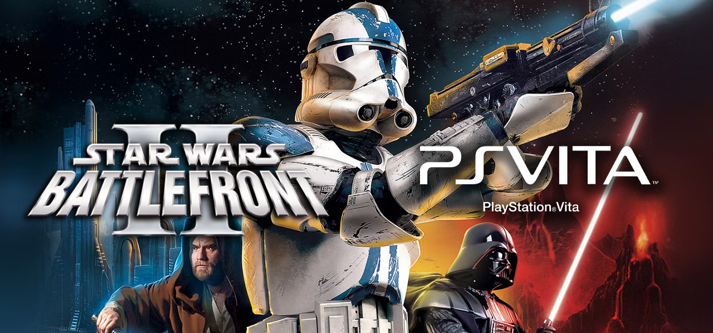
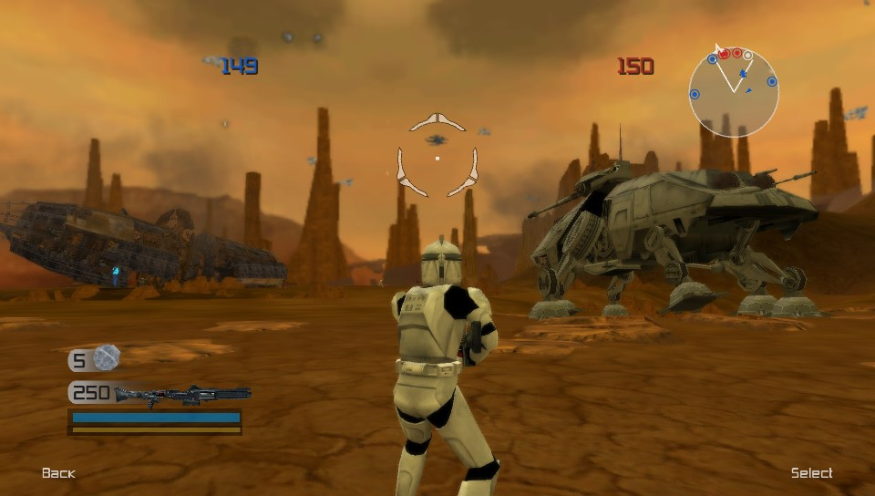
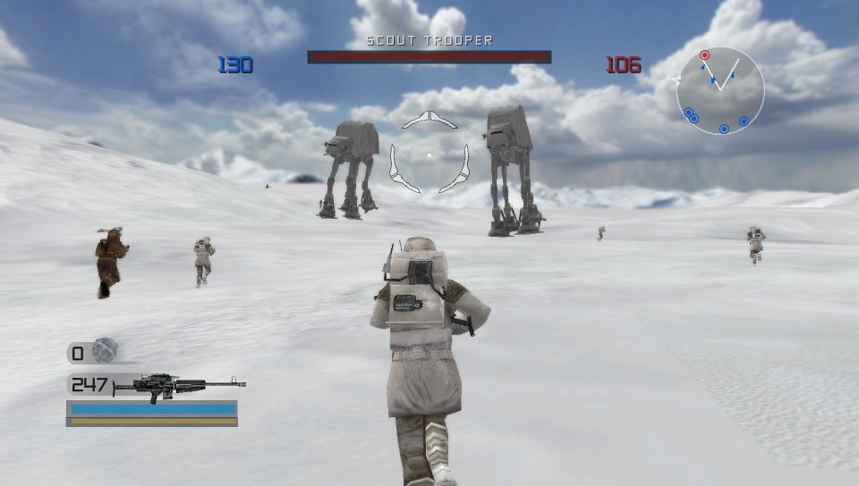

# Star Wars Battlefront II for PS Vita — Beta 1

**A native PS Vita port of the 2005 classic, running on your own copy of the PC game.**

This is the first public beta release of a custom built port of **Star Wars: Battlefront II (2005)**
on the PS Vita using the data files from **your own copy of the PC game**. The VPK contains no game
content.

This is a **beta**: every ground Conquest mission is playable, but expect rough edges, some missing
effects, incomplete mechanics, and frame-rate dips on the biggest outdoor maps.

## What you need

- A PS Vita (or PS TV) with **HENkaku/Ensō** and **VitaShell**.
- **Your own PC copy of Star Wars Battlefront II (2005)** (Steam or GOG).
- Free space on `ux0:` for the PC game's `GameData` folder.

## Install

1. Download `swbf2-vita.vpk` from this repository's **Releases** page and install it with VitaShell.
2. Copy the PC game's `GameData` folder to `ux0:data/swbf2/GameData/`, keeping its layout. The app
   reads `ux0:data/swbf2/GameData/data/_lvl_pc/`.
3. *Optional, for the console-style menu frames:* from the official **Battlefront II Mod Tools**,
   copy `BF2_ModTools/data/Common/interface/` to
   `ux0:data/swbf2/BF2_ModTools/data/Common/interface/`. Without it the menus use the PC frames.
4. Launch **Star Wars Battlefront II** from the LiveArea.

## What's in this beta

- **33 ground Conquest missions across 18 maps**, in the eras the retail mission list gives each map:
  Geonosis, Mygeeto, Mos Eisley, Coruscant, Death Star, Hoth, Mustafar, Naboo, Tantive IV, Dagobah,
  Endor, Felucia, Kamino, Yavin 4, Kashyyyk, Polis Massa, Utapau and Jabba's Palace.
- **Both Clone Wars and Galactic Civil War** factions and their retail class kits.
- Console-style menus, loading screens and background movies, from the game's own scripts (if using BF2ModTools).
- Retail movement, weapons, command posts, reinforcements and bleed, health/ammo droids and turrets.
- Ground vehicles (hovers, walkers, AT-AT), snowspeeders with tow cables, multiple seats and AI crews.
- Retail-derived AI: goals from the mission scripts, routes, aim, combat modes and locals
  (Geonosians, Wookiees, Ewoks, Gamorreans).
- Sky domes, far scenes, bloom/haze, heat haze, water, particle effects, sounds, voice-over and music.

### Not in this beta

Space battles, heroes, campaign, Galactic Conquest, Hunt, CTF, Assault, multiplayer and save data are **not** included.
Conquest is fully playable, with the issues listed below. Heroes are disabled by default; they can be enabled as an experimental feature in **Pause → Debug Options → Heroes** (they are very broken and intentionally left incomplete).

Project is currently closed source, and will be made open source with the 1.0 release (TBD).

## Screenshots

*Geonosis*

*Hoth*

## Gameplay Demo

## Controls

| Input | Action |
| --- | --- |
| Left stick | Move |
| Right stick | Look / aim |
| R | Fire |
| Square | Target lock (infantry) / secondary fire (vehicles)|
| L | Sprint / Boost |
| Bottom Left Touch Screen | Secondary weapon (grenade, etc.) |
| Bottom Right Touch Screen | Aim / Zoom |
| Cross | Jump / confirm |
| Circle | Back / switch vehicle seat |
| Triangle | Use / enter or exit vehicle |
| Left D-pad | Switch secondary weapon |
| Right D-pad | Switch primary weapon |
| Down D-pad | Reload |
| Up D-pad | Follow command |
| Start | Pause |

## Options

**Pause → Debug Options** has the performance settings:

- **FPS Cap** — 30 by default (steadier); turn it off to run uncapped.
- **Anti-Aliasing** — MSAA and FXAA combinations (MSAA changes apply after a restart).
- **Light / Shadows** — baked or ported lighting, blob or real-time unit shadows.

## Performance

Runs at a **stable 30 fps on most maps** on real hardware. A dynamic-resolution system drops to
**0.80** on a few foliage-heavy maps (Yavin 4, Kashyyyk, Endor) to hold the frame rate. Expect dips
when a lot of foliage is on screen.

## Known issues

- The main menu is functional but not a full recreation of the console front end; it uses the
  game's campaign cutscenes in place of the retail menu movie.
- Some AI units can get stuck in matches. AI behaviour is mostly implemented but has some bugs.
- Some unit abilities may not behave 1:1 with retail
- Some effects are missing (some scorch marks and ground foliage) and some distant scenery can differ
  from the console.
- No multiplayer, campaign, space battles, CTF/Hunt/Assault modes, or save data.
- Utapau GCW matches can drag on: vehicle AI chases targets through walls.
- Select doesn't open the map yet.
- No weather particles (snow on Hoth, rain on Kamino).
- Vehicles show no muzzle flash.
- The AT-ST second-seat camera is too low.
- Riders in turrets and vehicles don't tilt with their aim.
- The death camera is placeholder.
- Far scene geometry can be shaded incorrectly (Geonosis) or missing polygons (Hoth)
- Vehicles and infantry disappear at far distance, even when zoomed in

## Reporting a bug

Press **L + R + SELECT** in a match to save a snapshot of every unit's state
(`ux0:data/swbf2/blackbox/bb_NNN.txt`), then send it with `ux0:data/swbf2/swbf2render.log`, a short
description and, if you can, a screenshot.

## AI Disclaimer
This mod was made with the assistance of Claude. That being said, every build was tested by a real human being with real Vita hardware. Build features were implemented with a human in the loop reviewing, testing, and pushing back. Assisted by documentation and tools including [LibSWBF2](https://github.com/Ben1138/LibSWBF2) and [BF2GameExt](https://github.com/S1thK3nny/BF2GameExt) (see credits below).

## Enjoying the port?
Feel free to [buy me a coffee :)](https://buymeacoffee.com/drtezla)

## Source and license

This build is **GPL-3.0**. The corresponding source is at
[tezla55/swbf2-vita](https://github.com/tezla55/swbf2-vita); if you redistribute this VPK, you must
also make the source available under the GPL.

Star Wars Battlefront II and all of its content are the property of their respective owners. This
project is not affiliated with or endorsed by Lucasfilm, Disney, EA, Pandemic or LucasArts. The VPK
contains no game data; it bundles the LiveArea art, Sony's shader compiler and the Zeroes fonts for
convenience.

## Credits

- **Port, engine and tools:** tezla55.
- **Development assistant:** Claude, with every build tested by a human on real hardware.
- **[LibSWBF2](https://github.com/Ben1138/LibSWBF2):** Ben1138 and contributors.
- **[vitaGL](https://github.com/Rinnegatamante/vitaGL):** Rinnegatamante and contributors.
- **[BF2GameExt](https://github.com/S1thK3nny/BF2GameExt):** S1thK3nny
- **[SWBF2Pheonix](https://github.com/Ben1138/SWBF2Phoenix):** (used for documentation) Ben1138
- **[openbf](https://github.com/sprucey149/openbf):** (used for documentation) sprucey149
- **Lua 5.0:** Lua.org, with the SWBF2 bytecode patches.
- **FFmpeg / Bink:** the FFmpeg project and RAD Game Tools.
